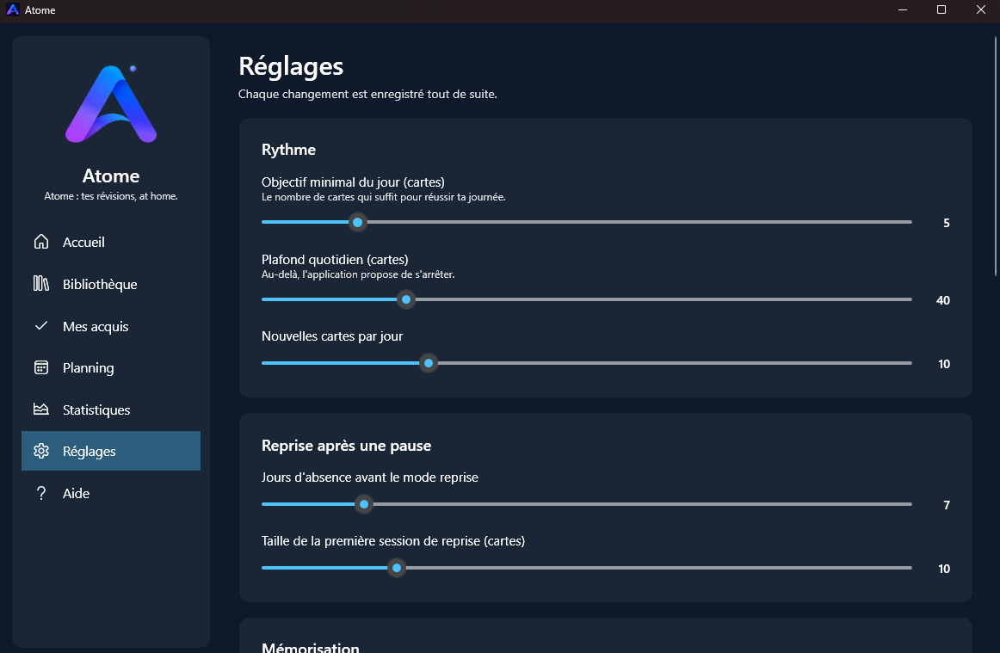

<p align="center">
  
</p>

<h1 align="center">Atome</h1>

<p align="center"><em>Tes révisions, at home.</em></p>

<p align="center">
  <a href="../../releases/latest"><strong>⬇ Télécharger Atome</strong></a> ·
  <a href="#créer-ses-propres-packs">Créer ses packs</a> ·
  <a href="../../issues">Signaler un bug</a>
</p>

> Application Windows de révision pour le **BTS SIO** : tu importes tes cours sous forme de « packs »,
> tu les lis dans l'application (Markdown et formules LaTeX, hors ligne), puis tu révises avec des cartes
> planifiées par **répétition espacée**, avec une gamification qui ne punit jamais une absence.

<p align="center">
  
  
</p>
<p align="center">
  
  
</p>
<p align="center">
  
  
</p>

**Version de test** : un bug, une idée ? Ouvre un [Issue](../../issues) sur ce dépôt.

**Atome** est mon tout premier projet. Il a été **entièrement généré par une IA (Claude, d'Anthropic)** :
je l'ai imaginé, guidé et testé, mais je n'ai pas écrit le code moi-même. Je l'ai fait pour mes propres
révisions de 1re année de BTS SIO option SLAM, en formation à distance, et je le partage à mes camarades.

## Ce qu'il faut savoir avant de commencer

- **Aucun cours n'est fourni** : ni dans ce dépôt, ni dans l'application. Les cours sont réservés à leurs
  destinataires, et chacun utilise **ses propres cours**.
- Un **pack d'exemple** est inclus ([`samples/exemple.json`](samples/exemple.json)) pour essayer l'application.
- Pour fabriquer tes propres packs à partir de tes PDF, il suffit de les donner à Claude avec un prompt
  prêt à l'emploi : voir [Créer ses propres packs](#créer-ses-propres-packs).
- L'application fonctionne **hors ligne**, sans compte, et tes données restent sur ton PC. Sa seule connexion :
  demander à GitHub, une fois par jour au plus, s'il existe une nouvelle version (désactivable dans les Réglages).

## Télécharger et installer

1. Va dans l'onglet **[Releases](../../releases)** de ce dépôt et télécharge la dernière version.
2. Lance `Atome-Setup-x.y.z.exe` et suis l'assistant (aucun droit administrateur nécessaire). Rien d'autre à installer.
3. **Windows peut afficher « Windows a protégé votre ordinateur »** (SmartScreen) : l'application n'est pas
   signée numériquement, ce qui coûte cher pour un projet personnel. Clique sur **Informations complémentaires**
   puis **Exécuter quand même**. Le code source est entièrement visible ici si tu veux vérifier.
4. Prérequis : Windows 10/11 et le **WebView2 Runtime** (déjà inclus dans Windows 11).

Pour essayer : **Bibliothèque** → importer `samples/exemple.json`.

### Mises à jour

Installé avec le setup, Atome vérifie au démarrage (une fois par jour au plus) s'il existe une nouvelle version
et la propose dans un bandeau : **Mettre à jour**, **Plus tard** ou **Ignorer cette version**. La mise à jour
télécharge `Atome-Setup-x.y.z.exe`, vérifie son empreinte SHA-256 (fichier `.sha256` publié avec la Release),
sauvegarde la base, puis installe et relance Atome. Tes données ne sont jamais touchées. En version portable,
le bandeau propose seulement le lien de téléchargement. Détails dans l'Aide, page **Mises à jour**.

## Créer ses propres packs

Un pack est un fichier JSON qui décrit une séance : le cours découpé en sections et des cartes de révision.
Claude peut le générer à partir de tes PDF :

1. Ouvre l'**Aide** dans l'application et clique sur **Copier le prompt** (ou ouvre [`docs/prompt-type.md`](docs/prompt-type.md)).
2. Colle-le dans une conversation avec Claude, en joignant le PDF de ta séance.
3. Enregistre le fichier JSON obtenu, puis dépose-le dans le dossier des packs (modifiable dans **Réglages**)
   ou importe-le depuis la **Bibliothèque**.

Le format exact est décrit dans [`docs/FORMAT.md`](docs/FORMAT.md).
**Ne publie jamais tes packs** : ils contiennent le contenu de tes cours.

## Documentation

- Format des packs : [`docs/FORMAT.md`](docs/FORMAT.md)
- Conception détaillée : [`PLAN.md`](PLAN.md)

## Lancer depuis le code source (développeurs)

Prérequis : Windows 10/11, **SDK .NET 10**, **WebView2 Runtime** (inclus dans Windows 11).

Depuis le dossier `app/` :

```bash
dotnet run --project src/Revisions.App
```

Pour fabriquer la version de tous les jours (dossier `app/publish`) et créer un raccourci sur le Bureau :

```bash
powershell -ExecutionPolicy Bypass -File publier.ps1 -Raccourci
```

Au démarrage, l'application importe automatiquement les packs de son dossier de packs (modifiable dans Réglages).

## Lancer les tests

```bash
dotnet test
```

708 tests : validation des packs, import et réimport (historique conservé), algorithme FSRS,
construction des sessions, mode reprise, XP, niveaux, série hebdomadaire, regroupement de la
bibliothèque en niveaux, couleurs et contrastes de chaque thème, enregistrement des réglages,
ordre du cours (tri naturel, chiffres romains) et tourniquet des matières, planning de l'année (priorités,
devoirs, avancement avant une échéance, dates personnelles, migration), TD en groupe (hasard maison
figé, codes et chiffre de contrôle, calcul matriciel, déterminisme des TD, vérification de la saisie, versions).

## Ce que fait l'application

- **Accueil** : la session du jour en un clic, objectif minimal, série en semaines, XP et niveau.
  Avec un planning : 1 à 3 séances « Au programme » et les prochaines échéances, sur un ton neutre.
- **Planning** : la proposition de ton organisme de formation en frises par matière (import direct d'un fichier Excel, voir l'aide).
  Dates modifiables (gardées dans la base, le fichier n'est jamais modifié),
  interrupteur général et par matière, quiz masquables. Sans planning, l'application suit l'ordre du cours.
- **Bibliothèque en tuiles** : matière → compétence (B1.2…) → séquence (SQ1…) → séances, avec fil
  d'Ariane, recherche, nombre de cartes à revoir et barre de maîtrise sur chaque tuile.
- **Lecture** : le cours section par section (Markdown, LaTeX, code coloré), PDF d'origine à la bonne page.
- **Session** : cartes question, QCM (choix mélangés) et exercice pas à pas ; sur une carte question,
  on peut **écrire sa réponse** pour la comparer à la bonne avant de se noter.
- **TD en groupe** : le même TD à plusieurs, chacun sur son PC (en vocal sur Discord par exemple), sans réseau :
  un **code court** à dicter (`MAT1-2-8-48217`) suffit à générer exactement les mêmes exercices partout.
  Premier thème : les **matrices** (dimension, somme, réel, transposée, identité, produit, puissance, situation
  concrète), avec grille de saisie, vérification case par case, indice et correction pas à pas ; second thème :
  les exercices et QCM de **n'importe quelle séance**. Code : `Revisions.Core/TdGroupe`.
- **Statistiques** : régularité, réussite par matière, points faibles avec session ciblée.
- **Réglages** : rythme, reprise, **thèmes** (clair, sombre, six thèmes colorés) et **couleur d'accent**.
- **Aide** : fonctionnement, raccourcis, ajout de cours, création d'un pack avec Claude (prompt à copier), données, signalement d'erreurs, mises à jour, TD à plusieurs sur Discord.
- **Signaler une erreur** : un petit drapeau sur chaque carte (session, fin de session) et chaque section en lecture, touche **S** en session. L'écran **Mes signalements** (Réglages) liste les signalements et les exporte en `signalements-<prénom>-<date>.json`, pour corriger les packs en lot (le texte vu au moment du signalement est conservé). Code : `Revisions.Core/Signalements`, `Revisions.Data/DepotSignalements.cs`.

## Organisation du code

```
app/
  src/
    Revisions.Core/     Cœur métier, sans interface ni base : modèles, validation des packs,
                        FSRS, construction des sessions, gamification, niveaux de la bibliothèque
                        (Bibliotheque/), couleurs et thèmes (Apparence/), ordre du cours (Ordre/),
                        planning (Planning/), mises à jour (MisesAJour/ : SemVer, API GitHub,
                        SHA-256, client HTTP injecté). TD en groupe (TdGroupe/ : hasard
                        SplitMix64, codes, générateurs de TD, matrices). Entièrement testable.
    Revisions.Data/     SQLite (Microsoft.Data.Sqlite + Dapper) : schéma, import, requêtes.
    Revisions.App/      Interface WPF en MVVM (CommunityToolkit.Mvvm) + rendu WebView2.
      ViewModels/       Un ViewModel par écran : toute la logique d'affichage.
      Views/            Les écrans en XAML (aucune logique dans le code-behind).
      Controles/        VueMarkdown : la zone qui affiche Markdown + LaTeX.
      Services/         État partagé, thème (ServiceTheme), WebView2, journal d'erreurs.
      Aide/             Pages de l'aide en Markdown, incorporées dans l'exécutable.
                        prompt-type.md est une copie de docs/prompt-type.md : la recopier si le prompt change.
      Web/              Page de rendu locale + markdown-it, KaTeX, highlight.js (hors ligne).
  tests/Revisions.Tests/  Tests xUnit.
  samples/exemple.json    Petit pack de démonstration (à importer depuis la Bibliothèque).
```

Sens des dépendances : `App → Data → Core`. Le Core ne dépend de rien.

## Choix techniques, en bref

| Sujet | Choix | Pourquoi |
| --- | --- | --- |
| Répétition espacée | **FSRS-5** (`Core/Planification/Fsrs.cs`) | Tient compte du temps réellement écoulé : adapté à un rythme irrégulier |
| Rendu du cours | WebView2 + markdown-it + KaTeX embarqués | Formules et code bien rendus, sans Internet |
| Base de données | SQLite, SQL écrit à la main | Simple, un seul fichier, et le SQL reste visible |
| Interface | WPF, MVVM, thème Fluent clair/sombre | Standard, testable, look Windows 11 |
| Validation des packs | Parcours manuel du JSON (`Core/Packs/LecteurPack.cs`) | Messages d'erreur précis : champ et carte en cause |
| Mises à jour | API GitHub `releases/latest`, setup Inno `/SILENT`, SHA-256 obligatoire (`Core/MisesAJour/`) | Pas de serveur à moi, pas de bibliothèque en plus, intégrité vérifiée avant tout lancement |

## Où sont mes données ?

`%LOCALAPPDATA%\RevisionsBTS\` :

- `revisions.db` : la base (cours importés, état des cartes, historique, XP, réglages) ;
- `sauvegardes\` : une copie automatique par jour d'utilisation, les 7 dernières sont gardées ;
- `journal.log` : erreurs éventuelles.

Pour restaurer une sauvegarde : fermer l'application, puis remplacer `revisions.db` par la copie voulue.

## Raccourcis clavier en session

| Touche | Action |
| --- | --- |
| Espace | Voir la réponse / l'étape suivante |
| 1, 2, 3, 4 | Raté, Difficile, Bien, Facile (rangée du haut avec ou sans Maj, ou pavé numérique) |
| A à E | Choisir une réponse de QCM |
| Entrée | Suite logique (révéler, continuer, ou « Bien ») |
| Tab | Entrer dans la zone de réponse écrite (cartes « question ») |
| Ctrl + Entrée | Depuis la zone : voir la réponse et comparer |
| Échap | Sortir de la zone (le texte est gardé) |
| ← → | Section précédente / suivante en lecture |

En **TD en groupe** : Tab et les flèches passent d'une case à l'autre, Ctrl + Entrée vérifie, Espace dit « go »
puis dévoile la correction étape par étape, Entrée (hors des cases) fait la suite logique, I donne l'indice.

## Liste de vérification manuelle

- [ ] Premier démarrage sans base : les packs sont importés, l'accueil propose une session.
- [ ] Lecture : une matrice, un tableau et un bloc de code s'affichent correctement.
- [ ] « Voir le PDF » ouvre le document à la page de la section.
- [ ] Session complète au clavier seul (question, QCM, exercice).
- [ ] Une carte ratée revient plus loin dans la session.
- [ ] Fin de session : chiffres cohérents, « Revoir la notion » ouvre la bonne section.
- [ ] Fermeture puis réouverture : XP, série et cartes dues sont conservées.
- [ ] Thème clair et thème sombre (Réglages).
- [ ] Changer de thème et de couleur d'accent : tout change tout de suite, et le choix est gardé au redémarrage.
- [ ] Carte « question » : écrire une réponse (Tab), Ctrl+Entrée, comparaison affichée, puis note au clavier.
- [ ] Bibliothèque : descendre dans les tuiles, revenir par « Retour » et par le fil d'Ariane, rechercher.
- [ ] Planning : changer une date, redémarrer, la date est gardée ; « Dates du fichier » la remet.
- [ ] Aide : « Copier le prompt » puis coller dans un éditeur de texte.
- [ ] Réimport d'un pack modifié : l'historique des cartes est conservé.
- [ ] TD en groupe : créer un TD, le rejoindre avec le code sur un 2e PC (même empreinte), grille au clavier (Tab, flèches, nombres négatifs), Ctrl + Entrée, correction avec Espace, récap et XP.

## Outils de développement (version Debug uniquement)

- `Atome.exe --ecran=bibliotheque` (ou `statistiques`, `reglages`, `lecture:<id du pack>`,
  `session:<id du pack>`, `aide:<numéro de page>`, `bibliotheque:0,1` pour descendre dans les tuiles,
  `bibliotheque:?texte` pour une recherche), `td` ou `td:<code>` (rejoint ce TD ; `td:<code>:demo` remplit
  une grille avec une erreur et vérifie, pour capturer l'écran de correction) ouvre directement un écran.
- `--theme=ocean` et `--accent=#D8498F` (ou `--accent=auto`) changent l'apparence au lancement ;
  `--hauteur=1700` agrandit la fenêtre pour capturer un écran long.
- Variable d'environnement `REVISIONS_DONNEES` : utilise un autre dossier de données, pour essayer
  sans toucher à son vrai historique.

## Licence

[MIT](LICENSE) © 2026 fjeko. La licence ne couvre que le code d'Atome, pas les cours.
