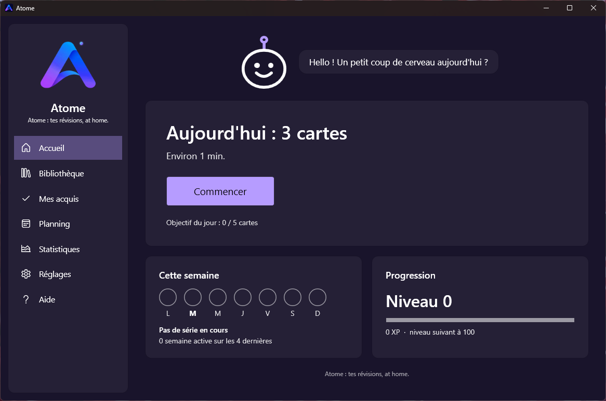
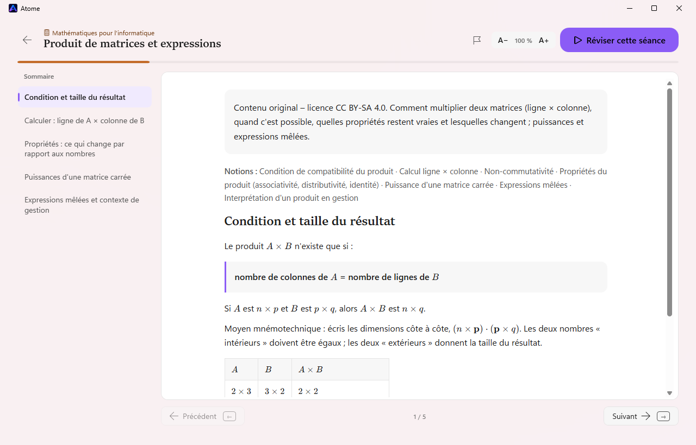
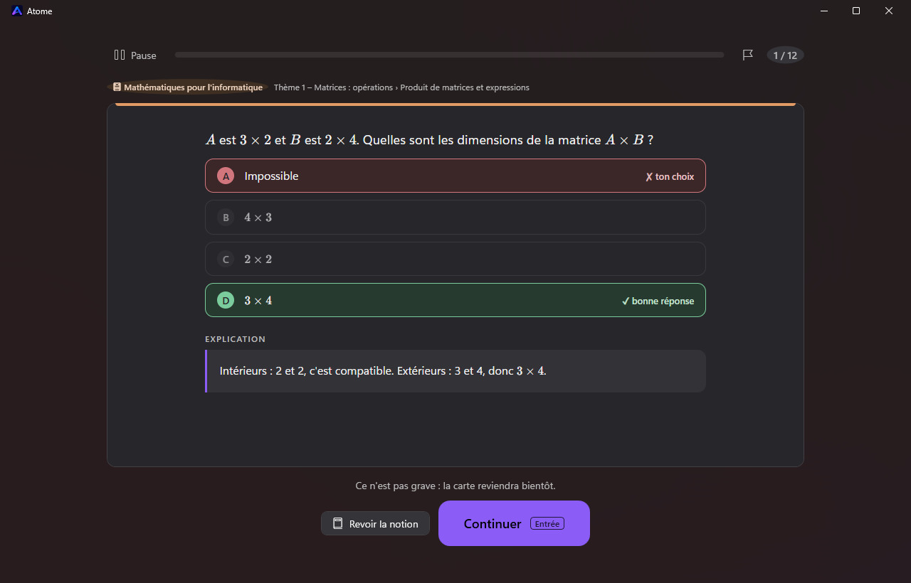
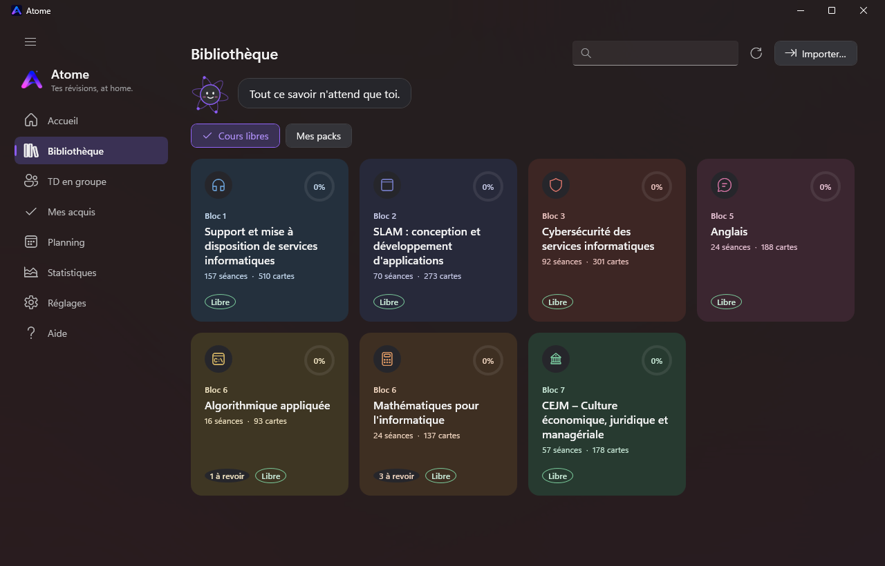
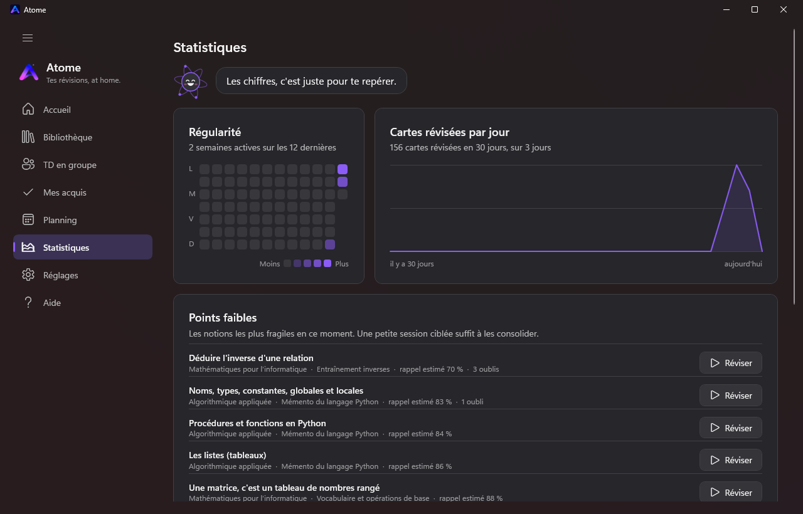
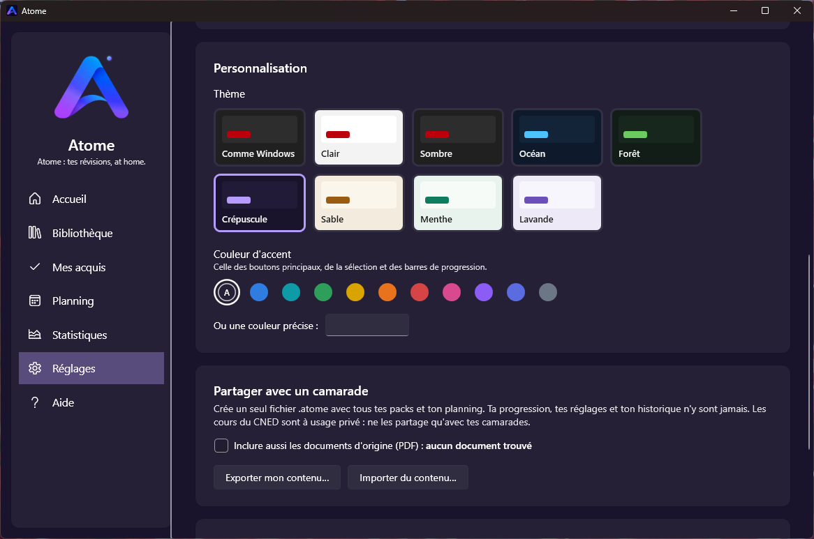

<p align="center">
  
</p>

<h1 align="center">Atome</h1>

<p align="center"><em>Tes révisions, at home.</em></p>

<p align="center"><strong>Projet étudiant BTS SIO SLAM</strong></p>

<p align="center">
  <a href="../../releases/latest"><strong>⬇ Télécharger Atome</strong></a> ·
  <a href="#cours-libres-intégrés">Cours libres</a> ·
  <a href="#créer-ses-propres-packs">Créer ses packs</a> ·
  <a href="../../issues">Signaler une erreur</a>
</p>

> Application Windows de révision pour le **BTS SIO** : tu lis tes cours dans l'application (Markdown et formules
> LaTeX, hors ligne), puis tu révises avec des cartes planifiées par **répétition espacée**, avec une
> gamification qui ne punit jamais une absence. Des **cours libres** sont livrés avec, pour commencer tout de suite.

<p align="center">
  
  
</p>
<p align="center">
  
  
</p>
<p align="center">
  
  
</p>
<p align="center">
  
</p>

**Atome** est mon tout premier projet. Il a été **entièrement généré par une IA (Claude, d'Anthropic)** :
je l'ai imaginé, guidé et testé, mais je n'ai pas écrit le code moi-même. Je l'ai fait pour mes propres
révisions de 1re année de BTS SIO option SLAM, en formation à distance, et je le partage à mes camarades.

## Fonctionnalités

- **Lecture des cours** : chaque séance se lit dans l'application, section par section (Markdown, formules LaTeX, code coloré).
- **Répétition espacée FSRS** : des cartes (question, QCM, exercice pas à pas) revues au bon moment, à ton rythme.
- **Révisions choisies et expliquées** : session du jour, une matière ou une partie, mes points faibles, ce que je viens de lire,
  préparer un devoir ; chaque carte dit pourquoi elle est là, et les nouvelles cartes attendent que tu aies lu le cours.
- **Gamification sans punition** : XP, niveaux, série comptée en semaines, mode reprise après une pause, plafond de cartes par jour.
- **Mes acquis** : tu déclares ce que tu maîtrises déjà, les cartes s'adaptent à ton niveau.
- **Planning CNED** : la proposition de ton organisme de formation en frises par matière, avec **import direct du fichier Excel**.
- **TD en groupe** : le même TD à plusieurs, chacun sur son PC, avec un simple code à dicter (sans réseau).
- **Signalements** : un petit drapeau sur chaque carte et chaque section pour signaler une erreur, exportable pour corriger les cours.
- **Partage `.atome`** : tes cours et ton planning dans un seul fichier, à donner à un camarade.
- **Collections** : tu choisis ce qui est affiché et révisé (cours libres, mes packs, contenus importés), sans perdre ta progression.
- **Mise à jour automatique** : Atome propose lui-même les nouvelles versions (sans toucher à tes données).
- **Cours libres intégrés** : 440 cours originaux du programme de 1re année, livrés avec l'application.
- **Calme et ludique** : thème sombre par défaut (clair et six thèmes colorés au choix), une couleur et une icône fixes
  par matière, une mascotte (un petit atome souriant) qui encourage sans jamais culpabiliser, taille du texte réglable,
  animations réductibles, sons facultatifs.
- **Hors ligne**, sans compte : tes données restent sur ton PC.

## Installation

1. Va dans l'onglet **[Releases](../../releases/latest)** et télécharge `Atome-Setup-x.y.z.exe`
   (ou `Atome-portable.zip`, sans installation : décompresse puis ouvre `Atome.exe`).
2. Lance le setup et suis l'assistant (aucun droit administrateur nécessaire, rien d'autre à installer).
3. **Windows peut afficher « Windows a protégé votre ordinateur »** (SmartScreen) : l'application n'est pas
   signée numériquement, ce qui coûte cher pour un projet personnel. Clique sur **Informations complémentaires**,
   puis **Exécuter quand même**.
4. Si le **Contrôle intelligent des applications** (Windows 11) bloque l'installation, désactive-le le temps
   d'installer (Sécurité Windows → Contrôle des applications et du navigateur), ou utilise le ZIP portable.
5. Prérequis : Windows 10/11 et le **WebView2 Runtime** (déjà inclus dans Windows 11).

Le code est entièrement visible ici si tu veux vérifier. Au premier lancement, sans aucun cours, Atome te propose de
charger les cours libres.

### Mises à jour

Installé avec le setup, Atome vérifie au démarrage (à chaque lancement, une fois par heure au plus, désactivable dans les Réglages) s'il
existe une nouvelle version et la propose dans un bandeau : **Mettre à jour**, **Plus tard** ou **Ignorer cette version**.
Le setup téléchargé est vérifié par son empreinte SHA-256, la base est sauvegardée, puis Atome se réinstalle et se
relance. Tes données et ta progression ne sont jamais touchées. C'est la seule connexion Internet d'Atome.

## Cours libres intégrés

Atome embarque **440 cours originaux** (séances de cours + cartes de révision) pour le programme de 1re année du BTS SIO
option SLAM : Bloc 1, Bloc 2, Bloc 3, algorithmique, mathématiques, anglais et CEJM.

- Ils ont été écrits en **« salle blanche »** : à partir de fiches abstraites (notions et savoir-faire seulement),
  sans jamais avoir sous les yeux les cours d'un organisme de formation, puis vérifiés par un contrôle de similarité.
  Détails dans [`contenu-libre/README.md`](contenu-libre/README.md).
- Licence **[CC BY-SA 4.0](contenu-libre/LICENSE)** : tu peux les réutiliser et les adapter en citant
  « Atome – packs libres BTS SIO » et en partageant tes modifications sous la même licence.
- Premier lancement sans aucun pack : Atome propose de les charger (**Oui** / **Plus tard**).
  Si tu as déjà tes propres packs, rien n'est chargé automatiquement : **Réglages → Mes collections** (ou les cases en
  haut de la Bibliothèque) permet d'afficher ou de masquer les cours libres, tes packs et les contenus importés, sans
  rien effacer. Ils portent un badge **Libre** dans la Bibliothèque. Une collection masquée sort de la Bibliothèque, des
  sessions, du planning et des statistiques, mais sa progression est conservée ; en la réaffichant, les cartes en retard
  reviennent étalées sur plusieurs jours, sans avalanche.
- Les mises à jour d'Atome mettent ces cours à jour, sans perdre ta progression.

## Ce qu'il faut savoir sur le contenu

- **Les cours du CNED ne sont pas fournis** : ni dans ce dépôt, ni dans l'application. Ils sont réservés à leurs
  destinataires. Chacun peut fabriquer des packs à partir de **ses propres cours** (voir ci-dessous) et ne doit jamais
  les publier.
- Un **pack d'exemple** est aussi inclus ([`samples/exemple.json`](samples/exemple.json)).
- Les cours libres sont écrits par une IA : **ils peuvent contenir des erreurs**. Aide-moi à les corriger, voir
  [Contribuer et signaler une erreur](#contribuer-et-signaler-une-erreur).

## Contribuer et signaler une erreur

- **Une erreur dans un cours ou une carte ?** Dans Atome, clique sur le petit drapeau (touche **S** en session),
  puis exporte tes signalements depuis **Réglages → Mes signalements**.
- **Un bug, une idée ?** Ouvre un [Issue](../../issues) sur ce dépôt, avec le nom de la séance ou la capture
  du problème.
- **Corriger un cours libre** : les packs sont de simples fichiers JSON dans [`contenu-libre/packs/`](contenu-libre/packs)
  (format dans [`docs/FORMAT.md`](docs/FORMAT.md)). Une *pull request* est la bienvenue, sous la même licence CC BY-SA 4.0.
- **Ne publie jamais de contenu tiré de cours protégés** (CNED ou autre).

## Communauté

Un bug, une coquille, un souci d'affichage, une idée ? Rejoins le serveur Discord d'Atome : **https://discord.gg/PkXXNhDvTm**
(tu y trouveras aussi les annonces de chaque nouvelle version).

## Créer ses propres packs

Un pack est un fichier JSON qui décrit une séance : le cours découpé en sections et des cartes de révision.
Claude peut le générer à partir de tes PDF :

1. Ouvre l'**Aide** dans l'application et clique sur **Copier le prompt** (ou ouvre [`docs/prompt-type.md`](docs/prompt-type.md)).
2. Colle-le dans une conversation avec Claude, en joignant le PDF de ta séance.
3. Enregistre le fichier JSON obtenu, puis dépose-le dans le dossier des packs (modifiable dans **Réglages**)
   ou importe-le depuis la **Bibliothèque**.

Le format exact est décrit dans [`docs/FORMAT.md`](docs/FORMAT.md).
**Ne publie jamais tes packs** : ils contiennent le contenu de tes cours.

---

# Pour les développeurs

## Documentation

- Format des packs : [`docs/FORMAT.md`](docs/FORMAT.md)
- Conception détaillée : [`PLAN.md`](PLAN.md)

## Lancer depuis le code source (développeurs)

Prérequis : Windows 10/11, **SDK .NET 10**, **WebView2 Runtime** (inclus dans Windows 11).

Depuis le dossier `app/` :

```bash
dotnet run --project src/Revisions.App
```

Pour fabriquer la version de tous les jours (dossier `app/publish`) et créer un raccourci sur le Bureau :

```bash
powershell -ExecutionPolicy Bypass -File publier.ps1 -Raccourci
```

Au démarrage, l'application importe automatiquement les packs de son dossier de packs (modifiable dans Réglages).

## Lancer les tests

```bash
dotnet test
```

1032 tests : validation des packs, import et réimport (historique conservé), algorithme FSRS,
construction des sessions (types de session, paquets de matière, motifs, verrouillage des cours non lus, durée estimée), mode reprise, XP, niveaux, série hebdomadaire, regroupement de la
bibliothèque en niveaux, couleurs et contrastes de chaque thème, système de design (contrastes WCAG AA de toutes les paires
texte / fond pour chaque thème et chaque accent, couleurs des matières, banque de messages de la mascotte), enregistrement des réglages,
ordre du cours (tri naturel, chiffres romains) et tourniquet des matières, planning de l'année (priorités,
devoirs, avancement avant une échéance, dates personnelles, migration), TD en groupe (hasard maison
figé, codes et chiffre de contrôle, calcul matriciel, déterminisme des TD, vérification de la saisie, versions).

## Ce que fait l'application

- **Accueil** : la mascotte dit bonjour (message choisi selon la journée), la session du jour en un gros bouton,
  l'objectif du jour en anneau, les matières du jour en tuiles colorées, la semaine en 7 pastilles, XP et niveau.
  Avec un planning : 1 à 3 séances « Au programme » et les prochaines échéances, sur un ton neutre.
  S'il manque des nouvelles cartes parce que leurs cours ne sont pas lus : « À lire pour débloquer de nouvelles cartes ».
- **Autre révision** : une matière ou une partie (arbre de la bibliothèque), mes points faibles (oublis FSRS et « Raté »
  de l'historique, séances sous 70 % de réussite, liste affichée avant de commencer), ce que je viens de lire (7 jours),
  préparer le prochain devoir du planning. Chaque choix affiche son nombre de cartes et une durée estimée.
- **Choix des cartes** (`Revisions.Core/Sessions/CompositeurSession.cs`) :
  - **paquets** de 4 à 6 cartes de la même matière (de la même partie si possible), qui alternent entre les matières (`Paquets.cs`) ;
    une carte ratée revient plus loin, si possible dans un paquet de sa matière (`SessionEnCours.cs`) ;
  - un **motif** sur chaque carte, sous le fil cliquable « Matière › Partie › Séance » : « À revoir · vue il y a 6 jours »,
    « Nouvelle · tu as lu ce cours », « Point faible · ratée 3 fois », « Préparation du devoir DV1 (semaine du 30/11) »… (`Motifs.cs`) ;
  - **pas de nouvelle carte d'un cours non lu** : une séance est « lue » dès qu'elle a été ouverte en lecture dans Atome
    (critère simple : l'ouverture affiche la première section), ou marquée Vu / Révisé dans Mes acquis.
    Réglage « Proposer des nouvelles cartes de cours non lus » (désactivé par défaut). Les cartes déjà vues ne sont jamais bloquées ;
  - collections masquées, plafond quotidien, limite de nouvelles cartes et mode reprise s'appliquent à tous les types de session.
- **Planning** : la proposition de ton organisme de formation en frises par matière (import direct d'un fichier Excel, voir l'aide).
  Dates modifiables (gardées dans la base, le fichier n'est jamais modifié),
  interrupteur général et par matière, quiz masquables. Sans planning, l'application suit l'ordre du cours.
- **Bibliothèque en tuiles** : matière → compétence (B1.2…) → thème ou séquence (Thème 1, SQ1…) → séances, avec fil
  d'Ariane, recherche, nombre de cartes à revoir et anneau de maîtrise sur chaque tuile (aux couleurs de la matière).
- **Lecture** : le cours section par section (Markdown, LaTeX, code coloré), texte limité à ~70 caractères par ligne,
  sommaire latéral, progression de lecture, taille du texte (A− / A+), PDF d'origine à la bonne page.
- **Session** : cartes question, QCM (choix mélangés) et exercice pas à pas ; sur une carte question,
  on peut **écrire sa réponse** pour la comparer à la bonne avant de se noter. Mode concentration (sans menu, F11 pour le
  plein écran), carte qui se retourne, « +10 » qui monte, pause avec confirmation douce (Échap).
- **TD en groupe** : le même TD à plusieurs, chacun sur son PC (en vocal sur Discord par exemple), sans réseau :
  un **code court** à dicter (`MAT1-2-8-48217`) suffit à générer exactement les mêmes exercices partout.
  Premier thème : les **matrices** (dimension, somme, réel, transposée, identité, produit, puissance, situation
  concrète), avec grille de saisie, vérification case par case, indice et correction pas à pas ; second thème :
  les exercices et QCM de **n'importe quelle séance**. Code : `Revisions.Core/TdGroupe`.
- **Statistiques** : calendrier de régularité (12 semaines), courbe des 30 derniers jours, réussite et maîtrise par matière,
  points faibles avec session ciblée.
- **Réglages** : révision (rythme, reprise), **apparence** (thème sombre par défaut, clair, six thèmes colorés, couleur
  d'accent, taille du texte, animations, sons, mascotte), collections, données, mises à jour.
- **Aide** : fonctionnement, raccourcis, ajout de cours, création d'un pack avec Claude (prompt à copier), données, signalement d'erreurs, mises à jour, TD à plusieurs sur Discord, comment Atome choisit tes cartes.
- **Signaler une erreur** : un petit drapeau sur chaque carte (session, fin de session) et chaque section en lecture, touche **S** en session. L'écran **Mes signalements** (Réglages) liste les signalements et les exporte en `signalements-<prénom>-<date>.json`, pour corriger les packs en lot (le texte vu au moment du signalement est conservé). Code : `Revisions.Core/Signalements`, `Revisions.Data/DepotSignalements.cs`.

## Organisation du code

```
app/
  src/
    Revisions.Core/     Cœur métier, sans interface ni base : modèles, validation des packs,
                        FSRS, construction des sessions, gamification, niveaux de la bibliothèque
                        (Bibliotheque/), couleurs, thèmes et charte du système de design (Apparence/ :
                        Charte, couleurs des matières), mascotte (Mascotte/ : banque de messages),
                        ordre du cours (Ordre/),
                        planning (Planning/), mises à jour (MisesAJour/ : SemVer, API GitHub,
                        SHA-256, client HTTP injecté). TD en groupe (TdGroupe/ : hasard
                        SplitMix64, codes, générateurs de TD, matrices). Entièrement testable.
    Revisions.Data/     SQLite (Microsoft.Data.Sqlite + Dapper) : schéma, import, requêtes.
    Revisions.App/      Interface WPF en MVVM (CommunityToolkit.Mvvm) + rendu WebView2.
      ViewModels/       Un ViewModel par écran : toute la logique d'affichage.
      Views/            Les écrans en XAML (aucune logique dans le code-behind).
      Themes/           Système de design : jetons (polices, rayons, marges), styles et composants.
      Controles/        VueMarkdown (Markdown + LaTeX) et composants : tuile de matière, anneau,
                        courbe, bandeau, tons de couleur (Ton.cs).
      Services/         État partagé, thème (ServiceTheme), animations (Mouvement), sons, toasts,
                        WebView2, journal d'erreurs.
      Aide/             Pages de l'aide en Markdown, incorporées dans l'exécutable.
                        prompt-type.md est une copie de docs/prompt-type.md : la recopier si le prompt change.
      Web/              Page de rendu locale + markdown-it, KaTeX, highlight.js (hors ligne).
  tests/Revisions.Tests/  Tests xUnit.
  samples/exemple.json    Petit pack de démonstration (à importer depuis la Bibliothèque).
  contenu-libre/         440 cours libres (CC BY-SA 4.0), copiés à côté de l'exe à la compilation ; DepotCoursLibres les charge ou les masque.
```

Sens des dépendances : `App → Data → Core`. Le Core ne dépend de rien.

## Choix techniques, en bref

| Sujet | Choix | Pourquoi |
| --- | --- | --- |
| Répétition espacée | **FSRS-5** (`Core/Planification/Fsrs.cs`) | Tient compte du temps réellement écoulé : adapté à un rythme irrégulier |
| Rendu du cours | WebView2 + markdown-it + KaTeX embarqués | Formules et code bien rendus, sans Internet |
| Base de données | SQLite, SQL écrit à la main | Simple, un seul fichier, et le SQL reste visible |
| Interface | WPF, MVVM, système de design maison (`Themes/`), Fluent pour les contrôles standard | Une seule source pour couleurs et tailles, contrastes testés, look Windows 11 |
| Validation des packs | Parcours manuel du JSON (`Core/Packs/LecteurPack.cs`) | Messages d'erreur précis : champ et carte en cause |
| Mises à jour | API GitHub `releases/latest`, setup Inno `/SILENT`, SHA-256 obligatoire (`Core/MisesAJour/`) | Pas de serveur à moi, pas de bibliothèque en plus, intégrité vérifiée avant tout lancement |

## Où sont mes données ?

`%LOCALAPPDATA%\RevisionsBTS\` :

- `revisions.db` : la base (cours importés, état des cartes, historique, XP, réglages) ;
- `sauvegardes\` : une copie automatique par jour d'utilisation, les 7 dernières sont gardées ;
- `journal.log` : erreurs éventuelles.

Pour restaurer une sauvegarde : fermer l'application, puis remplacer `revisions.db` par la copie voulue.

## Raccourcis clavier en session

| Touche | Action |
| --- | --- |
| Espace | Voir la réponse / l'étape suivante |
| 1, 2, 3, 4 | Raté, Difficile, Bien, Facile (rangée du haut avec ou sans Maj, ou pavé numérique) |
| A à E | Choisir une réponse de QCM |
| Entrée | Suite logique (révéler, continuer, ou « Bien ») |
| Tab | Entrer dans la zone de réponse écrite (cartes « question ») |
| Ctrl + Entrée | Depuis la zone : voir la réponse et comparer |
| Échap | Sortir de la zone (le texte est gardé) |
| ← → | Section précédente / suivante en lecture |

En **TD en groupe** : Tab et les flèches passent d'une case à l'autre, Ctrl + Entrée vérifie, Espace dit « go »
puis dévoile la correction étape par étape, Entrée (hors des cases) fait la suite logique, I donne l'indice.

## Liste de vérification manuelle

- [ ] Premier démarrage sans base : les packs sont importés, l'accueil propose une session.
- [ ] Lecture : une matrice, un tableau et un bloc de code s'affichent correctement.
- [ ] « Voir le PDF » ouvre le document à la page de la section.
- [ ] Session complète au clavier seul (question, QCM, exercice).
- [ ] Une carte ratée revient plus loin dans la session, si possible dans un paquet de sa matière.
- [ ] Accueil : « Session du jour » et « Autre révision… » ; chaque choix affiche cartes et durée ; motif et fil cliquable au-dessus des cartes.
- [ ] Une séance jamais ouverte ne donne pas de nouvelle carte ; l'ouvrir en lecture la débloque (ou le réglage « cours non lus »).
- [ ] Fin de session : chiffres cohérents, « Revoir la notion » ouvre la bonne section.
- [ ] Fermeture puis réouverture : XP, série et cartes dues sont conservées.
- [ ] Premier lancement en thème sombre ; thème clair et thèmes colorés (Réglages) ; Galerie (version Debug) lisible dans les deux.
- [ ] Taille du texte à 150 % : interface, cartes et lecture grossissent, rien ne déborde.
- [ ] Réduire les animations : plus de glissement ni de retournement, seulement des fondus courts.
- [ ] Changer de thème et de couleur d'accent : tout change tout de suite, et le choix est gardé au redémarrage.
- [ ] Carte « question » : écrire une réponse (Tab), Ctrl+Entrée, comparaison affichée, puis note au clavier.
- [ ] Bibliothèque : descendre dans les tuiles, revenir par « Retour » et par le fil d'Ariane, rechercher.
- [ ] Planning : changer une date, redémarrer, la date est gardée ; « Dates du fichier » la remet.
- [ ] Aide : « Copier le prompt » puis coller dans un éditeur de texte.
- [ ] Réimport d'un pack modifié : l'historique des cartes est conservé.
- [ ] TD en groupe : créer un TD, le rejoindre avec le code sur un 2e PC (même empreinte), grille au clavier (Tab, flèches, nombres négatifs), Ctrl + Entrée, correction avec Espace, récap et XP.

## Outils de développement (version Debug uniquement)

- `Atome.exe --ecran=bibliotheque` (ou `statistiques`, `reglages`, `lecture:<id du pack>`,
  `session:<id du pack>`, `choix` (écran « Autre révision »), `aide:<numéro de page>`, `bibliotheque:0,1` pour descendre dans les tuiles,
  `bibliotheque:?texte` pour une recherche), `td` ou `td:<code>` (rejoint ce TD ; `td:<code>:demo` remplit
  une grille avec une erreur et vérifie, pour capturer l'écran de correction), `galerie` (tous les composants du
  système de design, en sombre et en clair), `acquis`, `questionnaire` ouvre directement un écran.
- `--theme=ocean` et `--accent=#D8498F` (ou `--accent=auto`) changent l'apparence au lancement ;
  `--hauteur=1700` agrandit la fenêtre pour capturer un écran long ; `--defiler=800` fait défiler l'écran ;
  `--sans-galerie` cache l'entrée « Galerie » du menu (captures du README).
- Variable d'environnement `REVISIONS_DONNEES` : utilise un autre dossier de données (et compte comme une autre
  instance, à côté de l'Atome installé), pour essayer
  sans toucher à son vrai historique.

## Licences

- **Code d'Atome** : [MIT](LICENSE) © 2026 fjeko.
- **Cours libres** (`contenu-libre/`) : [CC BY-SA 4.0](contenu-libre/LICENSE), attribution « Atome – packs libres BTS SIO ».
- **Cours du CNED** : non fournis, réservés à leurs destinataires.
